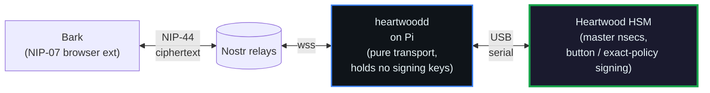

# Heartwood ESP32

> **Beta:** firmware [`0.18.0-beta.19`](https://github.com/forgesworn/heartwood-esp32/releases/tag/v0.18.0-beta.19)
> adds an unlock phone over WiFi: Sapwood asks, the board shows five words to
> compare with the phone, and a hold adds it. Phone unlock needs the Cambium
> app, 0.6.0 or later; Cambium 0.7.0 can also scan a code from Sapwood instead
> of showing one. Seeds are sealed under a data key, and an enrolled phone
> unlocks the board after a power cut with one tap and no stable tag on the
> wire. **On a board with a PIN or vault key, turn it off before going back to
> beta.16 or older:** earlier firmware cannot read the sealed seed format.
> This release's hardware checks are in its notes.
> Keep an independent recovery copy and use small values while the complete
> destructive cross-board recovery matrix remains unfinished.

[](https://github.com/sponsors/TheCryptoDonkey)

A hardware signing device for Nostr on supported ESP32 boards: **Heltec WiFi LoRa 32 V3/V4**, **LilyGO/TENSTAR T-Display**, and **Waveshare ESP32-C6-LCD-1.47**. Pick the target with the board-aware build script. Heartwood holds multi-master nsec material and signs on request; master private keys never leave the chip. Signing is policy-gated: requests outside automatic authority need the physical button and are shown on the display, while an authenticated operator can install an exact per-client method/event-kind policy for unattended signing.

For the full architecture walkthrough with sequence diagrams and trust-boundary analysis, see [**docs/architecture.md**](docs/architecture.md).

The shared `common` crate (derivation, NIP-44/46, policy — `no_std`, host-tested) also powers [heartwood-ledger](https://github.com/forgesworn/heartwood-ledger), the same signer as a Ledger embedded app: same seed phrase, same npub, same personas, with curve operations on the secure element via the `ledger-backend` feature.



The device is always the component that produces the signature. Authority comes from either a physical button approval or a previously installed slot policy. New remotely managed v2 slots are exact and fail closed: methods and event kinds outside their ceiling are denied, while matching requests can run unattended only when `auto_approve=true`. The Pi-side bridge holds no master key and cannot expand that authority. The separate Sapwood operator key is more powerful: it can create/revoke clients and install a signing policy, so compromise of that key must be treated as compromise of the configured remote-management authority.

Deployment modes, selected at runtime from the NVS network config:

### Home HSM — USB-attached to a Raspberry Pi *(shipped)*

Holds the **master secrets** (up to 8 masters across bunker / tree-mnemonic / tree-nsec modes). All radios are disabled in this mode. The Pi running `heartwoodd` handles networking (Nostr relays, NIP-46 transport). The ESP32 handles all cryptography: decryption, signing, envelope construction. A compromised Pi cannot extract a master key or broaden a slot policy; an already-authorised client can still receive whatever signatures its current policy permits. Management UI via [Sapwood](https://github.com/forgesworn/sapwood) is served by the bridge.

### WiFi-standalone — on-chip relay client, no Pi *(shipped, opt-in)*

The ESP32 joins WiFi and connects to Nostr relays directly, running the full NIP-46 signing loop on-chip (`firmware/src/relay.rs`) — no Raspberry Pi. Keys still never leave the chip and NIP-44 is still decrypted on-device. Exact v2 client policies can permit unattended signing for a bounded method/event-kind set; other requests are denied or require the OLED/button according to their legacy policy. An unbound relay peer cannot enter the 30-second button loop: remote physical approval is available only after the client has been provisioned and slot-bound, so strangers cannot keep a shelf signer busy with prompts. Enabled only when the device is provisioned with an SSID + relay list (`mode="wifi"` in the NVS net config); the USB cable stays fully usable in parallel, so a bad SSID or relay is recoverable over the cable. Relay-side device management (kind 24134) is authenticated to a provisioned operator pubkey, uses a durable one-time mutation challenge, and can manage clients and staged WiFi changes remotely. A relay that requires NIP-42 sign-in is answered automatically, only when it asks, with a fixed-shape kind-22242 event bound to the relay URL the board dialled (masters and the per-boot probe key when unlocked, the one-time unlock key when locked, never personas); see `docs/SECURITY-MODEL.md`. USB can read password-redacted network/operator state, patch network fields with keep/set/clear password semantics, and replace the operator only through a separate stale-revision-checked physical confirmation. Seed replacement, PIN changes, factory reset, and OTA remain local/USB operations.

The device stores up to eight WiFi networks. At startup and after losing a connection, it scans and tries visible saved networks from strongest signal to weakest; saved order breaks ties and supplies hidden or unseen fallbacks. A failed network does not prevent the others being tried. While connected, background scans check for a better saved network: switching requires at least a 10 dB advantage in two consecutive scans, normally 30 seconds apart, with the first scan at least 60 seconds after joining. Switching waits while an approval, held result, update or network trial is active; failed targets are excluded from roaming for five minutes. Reordering a stored network never resends its password; per-SSID `keep` semantics resolve secrets on-device. Short button presses while idle page through identity, network (large SSID, live stage and signal strength), device and locker information.

This is the convenience tier — it accepts a larger attack surface (a live TCP/IP stack on a key-holding device) in exchange for dropping the Pi. The USB-attached mode above remains the high-assurance default; leave the radios off where that matters.

### Portable signer — battery-powered, BLE to phone *(roadmap)*

Holds a **child key** derived by the home HSM (`purpose="device/mobile"`). Only BLE enabled — short range, requires physical proximity. If lost or compromised, burn that branch on the HSM and derive a new one at the next index. The master secret and all other branches are untouched.

### Key hierarchy

```
Master secret (home HSM)
├── persona/social       — public Nostr identity
├── persona/forgesworn   — project identity
├── client/bray          — NIP-46 client key
├── device/mobile-0      — portable signer #0 ← child key lives here
├── device/mobile-1      — replacement if #0 is compromised
└── ...
```

The nsec-tree hierarchy means each device gets its own branch. Compromise of a child never threatens the root or siblings.

## Hardware

| Component | Detail |
|-----------|--------|
| Boards | Heltec WiFi LoRa 32 V3/V4; LilyGO/TENSTAR T-Display; Waveshare ESP32-C6-LCD-1.47 |
| Chip | ESP32-S3 (Heltec), classic ESP32 (T-Display), or ESP32-C6 (Waveshare) |
| Display | 128x64 SSD1306 OLED (Heltec), ST7789 TFT (T-Display), or JD9853 TFT (Waveshare C6) |
| GNSS | L76K on V4 only (available for portable mode) |
| LoRa | SX1262 (never initialised -- no use case for signing) |
| WiFi | Built in (off in USB-bridged mode; enabled in WiFi-standalone mode) |
| BLE | Built in (reserved for future portable mode; not built) |
| USB-C (V4) | Wired direct to native USB-Serial-JTAG on GPIO19/20 |
| USB-C (V3) | Wired through CP2102 bridge to UART0 on GPIO43/44 |
| Battery | JST PH 2.0 connector + charging circuit (portable mode) |
| Buttons | Board-specific local confirmation controls; T-Display provides two buttons |

## Setup

Install the ESP Rust toolchain:

```bash
cargo install espup ldproxy espflash
espup install
source ~/export-esp.sh
```

## Build

The crates are independent (there is no workspace root), so build each from its
own directory. Use a subshell, or `cd` back, so one command does not run inside
the previous crate's directory:

| Crate | Package | Purpose |
|-------|---------|---------|
| `common/` | `heartwood-common` | Shared crypto: nsec-tree derivation, NIP-44/NIP-04, NIP-46 types, frame protocol, policy and net-config types |
| `firmware/` | `heartwood-esp32` | ESP32 firmware for every board, plus the `heartwood-demo` board-check game bin |
| `heartwoodd/` | `heartwoodd` | Pi/host daemon: Hard mode (bridges a USB device) and Soft mode (software-backed signer, no ESP32) |
| `provision/` | `heartwood-provision` | Host CLI: provision, generate, and manage client policies over USB serial |
| `sign-test/` | `heartwood-sign-test` | End-to-end harness: sends NIP-46 requests over serial |
| `ota/` | `heartwood-ota` | Host-side serial OTA tool with SHA-256 verification |
| `ota-sign/` | `heartwood-ota-sign` | Release-key tool: keygen / sign / verify for firmware images |
| `esp8266-firmware/` | `heartwood-esp8266` | Bare-metal USB-tethered signer for the ESP8266 (untested on hardware, see its `FLASHING.md`) |
| `ui-preview/` | `ui-preview` | Host renderer for the device screens, sharing `firmware/src/layout.rs` |

```bash
(cd common && cargo test --no-default-features --features mnemonic-gen,cash)  # shared crypto tests
(cd provision && cargo build)              # host CLI tool
(cd firmware && cargo build)               # ESP32 firmware (V4 default)
```

`common`'s tests need the `cash` feature, so a bare `cargo test` there does not
compile; CI also runs a second invocation with `--features
nip44,nip46,nip04,ota-sign,device-identity,seed-encrypt,cash,compact-hashes`.

The firmware crate selects its board at compile time. The default cargo feature
is `heltec-v4`, but production builds should use the wrapper so the cargo
feature, target triple, MCU, and sdkconfig fragment cannot drift apart:

```bash
./scripts/build-firmware.sh v3 --release
./scripts/build-firmware.sh v4 --release
./scripts/build-firmware.sh tdisplay --release
./scripts/build-firmware.sh c6 --release
```

Or the manual form (the wrapper runs exactly these):

```bash
# A subshell, so your shell stays in the repository root for the flash steps below.
(
  cd firmware
  # V4 (default)
  cargo build --release
  # V3
  ESP_IDF_SDKCONFIG_DEFAULTS="sdkconfig.defaults;sdkconfig.defaults.heltec-v3" \
      cargo build --release --no-default-features --features heltec-v3
  # T-Display (classic ESP32)
  MCU=esp32 ESP_IDF_SDKCONFIG_DEFAULTS="sdkconfig.defaults;sdkconfig.defaults.tdisplay" \
      cargo build --release --target xtensa-esp32-espidf --no-default-features --features tdisplay
  # Waveshare ESP32-C6 (RISC-V)
  MCU=esp32c6 ESP_IDF_SDKCONFIG_DEFAULTS="sdkconfig.defaults;sdkconfig.defaults.c6" \
      cargo build --release --target riscv32imac-esp-espidf --no-default-features --features c6
)
```

The wrapper script also writes a board-tagged ELF copy to
`firmware/target/heartwood-<board>.elf` (release builds; `-debug.elf` for debug
builds) so you cannot accidentally flash the wrong binary onto the wrong
hardware. `<board>` is the argument you passed (`v3`, `v4`, `tdisplay`, `c6`).

## Flash & provision

### Direct flash (USB cable to build machine)

```bash
# Heltec V4 (default, native USB CDC, enumerates as /dev/ttyACM*)
./scripts/build-firmware.sh v4 --release
espflash flash firmware/target/heartwood-v4.elf

# Heltec V3 (CP2102 bridge, typically enumerates as /dev/ttyUSB* or /dev/cu.usbserial-*)
./scripts/build-firmware.sh v3 --release
espflash flash firmware/target/heartwood-v3.elf

# T-Display (classic ESP32) and Waveshare C6: same pattern
./scripts/build-firmware.sh tdisplay --release
espflash flash firmware/target/heartwood-tdisplay.elf
./scripts/build-firmware.sh c6 --release
espflash flash firmware/target/heartwood-c6.elf
```

Flash the board-tagged ELF the wrapper writes, not a path under
`firmware/target/<triple>/`: that path differs per board (the T-Display builds
for `xtensa-esp32-espidf`, the C6 for `riscv32imac-esp-espidf`, the Heltec boards
for `xtensa-esp32s3-espidf`).

For a first flash of a 4 MB board, prefer the Sapwood web flasher, or the
release's `bootloader-<board>.bin` and `partition-table-<board>.bin`. They are
generated by the esp-idf build, which the release workflow uses because
`espflash` can panic on the `config` partition's `0x40` subtype if given the
CSV (`.github/workflows/release.yml`).

**Always use `--release`** -- debug builds (~2.2MB) exceed the 2 MB OTA slot of the Heltec layout (`firmware/partitions.csv`).

### Remote flash via esptool (ESP32 attached to a Pi)

Build the app binary locally, transfer it, and flash with esptool on the Pi.

**Serial port naming depends on the board.** V4 enumerates as USB CDC
(`/dev/ttyACM0` on Linux) because it uses the ESP32-S3's native USB. V3
goes through a CP2102 UART bridge and enumerates as `/dev/ttyUSB0`.
Substitute the right path in the commands below.

```bash
# Build and convert to app binary (0xE9 format, not raw ELF)
./scripts/build-firmware.sh v4 --release      # or: v3
espflash save-image --chip esp32s3 firmware/target/heartwood-v4.elf /tmp/heartwood-esp32.bin
# (v3: firmware/target/heartwood-v3.elf; T-Display: --chip esp32 with
#  heartwood-tdisplay.elf; C6: --chip esp32c6 with heartwood-c6.elf)

# Transfer to the Pi
scp /tmp/heartwood-esp32.bin pi-host:/tmp/

# On the Pi: stop any process holding the serial port, then flash.
# PORT=/dev/ttyACM0 for V4, PORT=/dev/ttyUSB0 for V3.
PORT=/dev/ttyACM0
# On a Heltec V4 with native USB, watchdog-reset restored automatic startup
# after an app-only flash (verified once on beta.13); default hard-reset left
# that unit unresponsive until a physical reset.
# Use hard-reset for CP2102-connected V3 (not physically checked in this run).
AFTER_RESET=watchdog-reset  # V4; set to hard-reset for V3
sudo systemctl stop <heartwood-services>
sudo fuser -k "$PORT"
python3 -m esptool --chip esp32s3 --port "$PORT" --before default-reset --after "$AFTER_RESET" \
  write-flash 0x10000 /tmp/heartwood-esp32.bin

# Heltec only: erase otadata to force boot from ota_0. Skip this on the
# T-Display and C6: their 4 MB layout has no otadata, and 0xd000 lies inside nvs.
python3 -m esptool --chip esp32s3 --port "$PORT" --before default-reset --after "$AFTER_RESET" \
  erase-region 0xd000 0x2000
```

**Important:** if any daemon holds the serial port, the flash will fail mid-write. Use `systemctl mask` (not just `stop`) if services auto-restart, and stop `ModemManager` which probes new serial devices on USB re-enumeration.

### OTA update (over serial, device already running)

Serial OTA works on the Heltec boards only: they carry two 2 MB A/B slots
(`firmware/partitions.csv`). The T-Display and C6 have a single 3 MB factory
slot (`firmware/partitions-4mb.csv`) and no A/B rollback, so they update with an
app-only reflash instead: the `esptool` write at `0x10000` in the section above
(`--chip esp32` or `--chip esp32c6`, no otadata erase) or Sapwood's quick USB update.

Build and install the OTA tool once (it installs as `heartwood-ota`):

```bash
(cd ota && cargo install --path .)
```

Then update:

```bash
# Stop the daemon holding the serial port
sudo systemctl stop <heartwood-service>

# Flash via OTA (requires button approval on the device -- hold 2s).
# PORT=/dev/ttyACM0 for V4, PORT=/dev/ttyUSB0 for V3.
heartwood-ota --port /dev/ttyACM0 --firmware /tmp/heartwood-esp32.bin
# The release signature is read from /tmp/heartwood-esp32.bin.sig by default
# (every release ships one per app image); pass --sig <file> to name another.

# Restart the daemon
sudo systemctl start <heartwood-service>
```

The firmware binary must be an app binary (use `espflash save-image`), not the raw ELF from `cargo build`. Release-key custody and signing are covered in [docs/ota-signing.md](docs/ota-signing.md).

### Provision

After first flash, wait for OLED to show "Awaiting secret...", then:

```bash
(cd provision && cargo run -- --port /dev/cu.usbserial-* provision)
```

`provision` restores an existing secret; `generate` makes a fresh one on the
offline host and shows its recovery words once (see `cargo run -- --help`).
Enter mnemonic and passphrase when prompted. After ACK, the device reboots with the stored identity.

Sapwood and Heartwood `0.18.0-beta.2` produce typed 19/31-word recovery sequences with
an embedded recovery kind, nsec-tree version, and public fingerprint. The
provision CLI recognises these automatically. `--mode bunker`, `--mode
tree-nsec`, and `--mode tree-mnemonic` now apply only to explicit legacy nsec or
bare BIP-39 input. Historical 24-word key backups remain supported but require
the original meaning to be selected out of band. Format and instructions:
[sapwood/docs/key-backup.md](https://github.com/forgesworn/sapwood/blob/main/docs/key-backup.md).

Subsequent boots display the master npub immediately (no provisioning needed).

## Quick start

From a flashed board to a first signature, USB-bridged mode. Build the host
tools first (`(cd provision && cargo build)`, `(cd sign-test && cargo build)`,
`(cd heartwoodd && cargo build)`), and substitute your serial port.

1. Provision. Wait for the OLED to show "Awaiting secret...", then, on an
   offline machine, generate a fresh identity (recovery words are shown once and
   never written to disk) and a bridge secret for the daemon:

   ```bash
   (cd provision && cargo run -- --port /dev/ttyACM0 generate --label primary --gen-bridge-secret)
   ```

   The command prints the bridge secret; keep it for step 3. To restore an
   existing identity instead, use the `provision` subcommand above.

2. Check the signer directly. Stop anything holding the port, then ask for the
   public key and a signature. `sign-test` speaks the plaintext cable frame,
   which the device refuses once a bridge session is authenticated, so run it
   before step 3, while no bridge session has authenticated since the device
   last started. `sign_event` needs a button hold on the device:

   ```bash
   (cd sign-test && cargo run -- --port /dev/ttyACM0 --method get_public_key)
   (cd sign-test && cargo run -- --port /dev/ttyACM0 --method sign_event --kind 1 --content "hello")
   ```

   Run these from the repository root; each subshell leaves your shell where it
   was. `sign-test` prints the request it sends, then the device's reply. For
   `get_public_key` the request carries an optional `heartwood` derivation
   context (`--purpose persona/social --index 0` fills it in; without `--purpose`
   it is `null`), and the reply is the requested public key as hex (the
   master's without `--purpose`), after which `sign-test` prints the matching
   `npub`:

   ```json
   {
     "heartwood": null,
     "id": "sign-test-1",
     "method": "get_public_key",
     "params": []
   }
   ```

   ```json
   {
     "id": "sign-test-1",
     "result": "<64 hex characters>"
   }
   ```

   For `sign_event`, `params[0]` is the unsigned event as a JSON string, with a
   zero placeholder `pubkey` that the device replaces with the signing key's. The
   reply's `result` is the signed event, again as a JSON string (hex values
   shortened here):

   ```json
   {
     "heartwood": null,
     "id": "sign-test-1",
     "method": "sign_event",
     "params": [
       "{\"content\":\"hello\",\"created_at\":1760000000,\"kind\":1,\"pubkey\":\"0000...0000\",\"tags\":[]}"
     ]
   }
   ```

   ```json
   {
     "id": "sign-test-1",
     "result": "{\"id\":\"3f9a...\",\"pubkey\":\"79be...\",\"created_at\":1760000000,\"kind\":1,\"tags\":[],\"content\":\"hello\",\"sig\":\"c2d4...\"}"
   }
   ```

   A refused or failed request comes back as `{"id": "sign-test-1", "error":
   "<message>"}` with no `result`. Over a relay the same `id`/`method`/`params`
   object travels NIP-44 encrypted inside a NIP-46 kind 24133 event.

3. Run `heartwoodd` (below), then take the bunker URI from
   `<data-dir>/bunker-uri.txt`. It has the form
   `bunker://<master pubkey hex>?relay=<url>&relay=<url>`. For a per-client URI
   that carries a connect secret and its own policy, create a slot and fetch its
   URI from the management API:

   ```bash
   TOKEN=$(sudo cat /var/lib/heartwood/api-token)   # unless you set HEARTWOOD_API_TOKEN
   curl -s -X POST -H "Authorization: Bearer $TOKEN" -H 'Content-Type: application/json' \
        -d '{"label":"my client"}' http://127.0.0.1:3100/api/slots/0
   curl -s -H "Authorization: Bearer $TOKEN" http://127.0.0.1:3100/api/slots/0/0/uri
   # {"bunker_uri":"bunker://..."}
   ```

4. Paste the `bunker://` URI into a NIP-46 client. Requests outside an installed
   policy appear on the OLED and need a button hold.

To run WiFi-standalone instead of using a Pi, stage a network config with
`mode="wifi"`, an SSID and a relay list, either through Sapwood or over USB with
`node scripts/net-config.mjs --port /dev/ttyACM0 --set-config net.json` (the file
holds `{ ssid, password, relays, mode }`; the board shows a card to confirm, and
a wifi save reboots it).

### Run heartwoodd

`heartwoodd` is the Pi-side daemon. There is no unit file in this repository:
run it directly or under a unit of your own naming (the `<heartwood-service>`
placeholder above stands for that unit). It restarts itself by exiting on
`POST /api/daemon/restart`, so run it under a supervisor such as systemd.

```bash
export HEARTWOOD_BUNKER_SECRET=<64 hex chars or nsec>   # relay-layer transport identity, Hard mode
export HEARTWOOD_BRIDGE_SECRET=<64 hex chars>           # printed by `provision`/`generate --gen-bridge-secret`
heartwoodd --port /dev/ttyACM0 --relays wss://relay.damus.io,wss://nos.lol
```

Secrets are read from the environment, not argv, so they stay out of
`/proc/<pid>/cmdline`:

| Variable | Flag | Purpose |
|----------|------|---------|
| `HEARTWOOD_BUNKER_SECRET` | `--bunker-secret` | Relay-layer transport key (nsec or hex). Required in Hard mode; Soft mode generates an ephemeral one if omitted. It holds no signing authority. |
| `HEARTWOOD_BRIDGE_SECRET` | `--bridge-secret` | 64-hex session secret that must match the device's stored bridge secret |
| `HEARTWOOD_API_TOKEN` | `--api-token` | Bearer token for `/api/*`. If unset, one is generated into `<data-dir>/api-token` (mode 0600) |
| `HEARTWOOD_PIN` | `--pin` | Boot PIN (4-8 digits), sent before session auth, only if the device has one |

Other flags and their defaults: `--mode auto|hard|soft` (`auto` probes the
serial port and falls back to Soft mode), `--port /dev/ttyACM0`, `--baud 115200`,
`--data-dir /var/lib/heartwood`, `--relays wss://relay.damus.io,wss://nos.lol`,
`--slot 0` (master whose URI goes into `bunker-uri.txt`), `--api-port 3100`,
`--bind 127.0.0.1`, `--sapwood-dir <path>` (serve Sapwood same-origin), `--cors`
(off), and the one-shot `--vault-enable` / `--vault-disable`. The API is plain
HTTP, so keep it on loopback and reach it through an SSH tunnel or a TLS proxy.

Management API on `:3100` (bearer token required except where noted):

| Route | Purpose |
|-------|---------|
| `GET /api/info` | Tier, locked state, relays, uptime (no token) |
| `GET /api/logs` | WebSocket log stream; token as `?token=` |
| `GET /api/status` | Masters and daemon summary |
| `POST /api/masters`, `DELETE /api/masters/{slot}` | Add or remove a master |
| `GET`/`POST /api/slots/{master}` | List or create connection slots (`{"label": ...}`) |
| `PUT`/`DELETE /api/slots/{master}/{index}` | Update (label, policy) or revoke a slot |
| `GET /api/slots/{master}/{index}/uri` | `{"bunker_uri": ...}` for that slot |
| `GET /api/vault/status`, `POST /api/vault/enable`, `POST /api/vault/disable`, `GET /api/vault/export` | At-rest vault key |
| `POST /api/unlock`, `POST /api/lock` | Soft mode keystore unlock and lock |
| `GET /api/approvals`, `POST /api/approvals/{id}` | Soft mode approval queue (`{"action":"approve"\|"deny"}`) |
| `GET /api/backup`, `POST /api/backup/export`, `POST /api/backup/import`, `GET /api/backup/status`, `PUT /api/backup/passphrase` | Encrypted backup of slots and policies |
| `POST /api/device/factory-reset`, `POST /api/device/ota` | Device operations |
| `POST /api/daemon/restart` | Exit so the supervisor restarts the daemon |

## Frame protocol

Every serial exchange between the device and a host tool is one frame
(`common/src/frame.rs`, constants in `common/src/types.rs`):

| Field | Size | Value |
|-------|------|-------|
| Magic | 2 bytes | `0x48 0x57` ("HW") |
| Type | 1 byte | see below |
| Length | 2 bytes | payload length, unsigned, big-endian; at most 32768 |
| Payload | `length` bytes | type-specific, usually JSON |
| CRC32 | 4 bytes | big-endian; standard CRC-32 (IEEE 802.3, as in zlib) over type, length and payload, not the magic |

Common type codes (the full list, with payload layouts, is in `common/src/types.rs`):

| Code | Name | Direction |
|------|------|-----------|
| `0x01` | `PROVISION` | host to device |
| `0x02` / `0x03` | `NIP46_REQUEST` / `NIP46_RESPONSE` (plaintext, refused once a bridge session is authenticated) | host to device / reply |
| `0x05` / `0x07` | `PROVISION_LIST` / `PROVISION_LIST_RESPONSE` | host to device / reply |
| `0x06` / `0x15` | `ACK` / `NACK` | device to host |
| `0x10` / `0x11` | `ENCRYPTED_REQUEST` / `ENCRYPTED_RESPONSE` (NIP-44 ciphertext; the Pi only relays these) | host to device / reply |
| `0x21` / `0x22` | `SESSION_AUTH` / `SESSION_ACK` | host to device / reply |
| `0x30`-`0x32` | `OTA_BEGIN` / `OTA_CHUNK` / `OTA_FINISH` | host to device |
| `0x33` | `OTA_STATUS` | device to host |
| `0x34` / `0x35` | `SIGN_ENVELOPE` / `SIGN_ENVELOPE_RESPONSE` | host to device / reply |
| `0x40`-`0x49` | Connection slot create, list, update, revoke and URI | host to device / reply |
| `0x54` | `SET_NET_CONFIG` | host to device |
| `0x59` / `0x5A` | `FIRMWARE_INFO` / `FIRMWARE_INFO_RESPONSE` | host to device / reply |

## Test vector

| Parameter | Value |
|-----------|-------|
| Root secret | `[0x01, 0x02, ..., 0x20]` (32 bytes, sequential) |
| Root path | Raw secret → SigningKey (no HMAC intermediate) |
| Purpose | `persona/test` |
| Index | `0` |
| Expected child npub | `npub1rx8u4wk9ytu8aak4f9wcaqdgk0lj4rjhdu4j9n7dj2mg68l9cdqs2fjf2t` |

This must match heartwood-core's output for the same inputs. The nsec-tree derivation is:

```
context = b"nsec-tree\0" || b"persona/test" || 0x00 || 0x00000000
child_secret = HMAC-SHA256(key=root_secret, msg=context)
child_pubkey = SigningKey(child_secret).verifying_key()
npub = bech32_encode("npub", child_pubkey)
```

## GPIO safety

Verified against Heltec factory test code, Meshtastic firmware, and ESPHome configs:

- **GPIO 17, 18, 21** -- OLED I2C, shared wiring on both V3 and V4.
- **GPIO 19, 20** -- native USB D-/D+ on V4. Not wired to USB-C on V3, so `UsbSerialDriver` will never enumerate on V3; the V3 code path uses UART0 instead.
- **GPIO 43, 44** -- UART0 TX/RX on both boards, but only V3 has them wired through to the USB-C port via the CP2102 bridge.
- **PSRAM pins** on ESP32-S3R2 (V4 only) are GPIO 26-32 (quad-SPI). Nowhere near our I2C pins. The V3 has no PSRAM.
- **GPIO 33-37** are free on both boards (only reserved on octal PSRAM variants like S3R8).

## Structure

```
common/                  Shared crypto, frame protocol, NIP-46/44/04 types
  src/
    lib.rs, derive.rs, encoding.rs, types.rs, hex.rs, frame.rs
    nip46.rs            NIP-46 event types, canonical serialisation, event id
    nip44.rs            NIP-44 v2 (XChaCha20 + HMAC-SHA256, conversation key)
    nip04.rs            NIP-04 legacy (AES-256-CBC)
firmware/                ESP32 firmware (NIP-46 signing bunker)
  src/
    main.rs             Boot flow → PIN unlock → frame dispatch loop
    sign.rs             BIP-340 Schnorr signing (secp256k1 C FFI)
    nvs.rs              NVS read/write for masters, bridge secret, policies, PIN
    provision.rs        Multi-master provisioning (add/remove/list)
    transport.rs        0x10 encrypted requests + 0x34 SIGN_ENVELOPE handler
    session.rs          Bridge session auth (0x21/0x22) + SET_BRIDGE_SECRET (0x23)
    policy.rs           Client approval policies, two-tier TOFU
    ota.rs              Serial OTA (0x30-0x33) with SHA-256 + auto-rollback
    pin.rs              Boot PIN, NVS-persisted failed-attempt counter
    nip46_handler.rs    NIP-46 dispatch (sign_event, connect, NIP-44/04, heartwood_*)
    identity_cache.rs   Derived persona cache for tree-mode masters
    approval.rs         Button approval loop with OLED countdown
    oled.rs             SSD1306 display helpers, boot animation
    masters.rs          LoadedMaster lookup, npub encoding
  build.rs, sdkconfig.defaults, rust-toolchain.toml, .cargo/config.toml
provision/               Host CLI tool
  src/
    main.rs             Mnemonic / nsec / hex → serial push to device
sign-test/               Signing test harness
  src/
    main.rs             Send NIP-46 requests over serial, display responses
heartwoodd/              Pi-side daemon (formerly bridge/)
  src/
    main.rs             Nostr relay ↔ NIP-44 transport ↔ serial ↔ ESP32
                        Master-routed, calls SIGN_ENVELOPE for outer events
    api.rs              Management HTTP API on :3100, bearer-token auth
    backend/            Soft mode (sealed keyfile) and hard mode (serial) backends
ota/                     Pi-side serial OTA tool
  src/
    main.rs             Chunked firmware upload with SHA-256 verification
ota-sign/                Release-key tool: keygen / sign / verify for firmware images
  src/
    main.rs             Shares common/src/ota_sign.rs with the device verifier
esp8266-firmware/        Bare-metal USB-tethered signer for the ESP8266
                        (untested on hardware; see FLASHING.md and NOTES.md)
ui-preview/              Host renderer for the device screens (shares firmware/src/layout.rs)
scripts/
  setup-hsm.py          Interactive provisioning and bridge-start helper
  git-hooks/            Pre-commit secret scanner (64-hex + nsec1 detection)
  install-hooks.sh      Installer for the git hooks
docs/
  architecture.md       System architecture with mermaid diagrams
  plans/                Design notes, including the zero-trust bridge refactor plan
  specs/                Protocol specs
```

## Roadmap

### Phase 1 — Prove the crypto (current spike)

- [x] nsec-tree HMAC-SHA256 derivation on ESP32-S3
- [x] bech32 npub encoding
- [x] Runtime assertion against heartwood-core test vectors
- [x] Display npub on OLED
- [x] Sign a dummy 32-byte hash and display the signature

### Phase 2 — Provisioning

- [x] CLI tool to derive 32-byte root secret from mnemonic + passphrase (offline PC)
- [x] NVS storage for root secret (plaintext — encryption deferred, see excluded)
- [x] First-boot provisioning mode: accept root secret over USB serial
- [x] Subsequent boots read from NVS, skip provisioning
- [x] Show master npub on OLED after boot

### Phase 3 — USB signing oracle

- [x] NIP-46 JSON-RPC over serial (ESP32 is the bunker, Pi is a transport bridge)
- [x] Unified frame protocol: `[magic][type][length][payload][crc32]`
- [x] OLED shows what you're signing (identity, event kind, content preview, countdown)
- [x] Physical button: long hold (>=2s) to approve, short press to deny, 30s timeout
- [x] Per-request child key derivation with Heartwood extension field
- [x] Test harness CLI (`sign-test/`) for end-to-end validation
- [x] Flash and verify end-to-end signing flow on hardware (2026-04-03)
- [x] Pi-side relay bridge (`heartwoodd/`): NIP-46 over Nostr relays ←→ NIP-44 ←→ serial ←→ ESP32

### Phase 4 — Full NIP-46 HSM *(shipped)*

- [x] Multi-master NVS storage (up to 8 masters, three modes: bunker/tree-mnemonic/tree-nsec)
- [x] Extended provisioning protocol (add/remove/list masters with mode + label)
- [x] NIP-44 v2 on-device (conversation key derivation + XChaCha20 + HMAC-SHA256)
- [x] NIP-04 legacy on-device (AES-256-CBC)
- [x] Zero-trust Pi transport (ESP32 decrypts inbound 0x10 frames, Pi only sees ciphertext)
- [x] Bridge session authentication (shared secret, constant-time comparison)
- [x] Client approval policies (per-master, per-client): stored with each connection slot in NVS (`firmware/src/policy.rs`), so they survive a reboot. Legacy slots keep first-sign TOFU; v2 slots carry an exact method and event-kind policy installed by the authenticated operator (Sapwood, or the `heartwoodd` slot API), and fail closed outside it
- [x] Policy engine (auto-approve / OLED-notify / button-required tiers)
- [x] NIP-46 core methods plus Heartwood extension dispatch (proof generation/verification currently return explicit `not yet implemented` errors)
- [x] Multi-master OLED UX (boot screen, bridge status, master labels, auto-approve flash)
- [x] Bridge passthrough mode (0x10/0x11 encrypted frames, fallback to legacy)
- [x] `connect` method with per-master connect secret validation + two-tier TOFU
- [x] Encrypted response flow (handler returns JSON, transport encrypts 0x11)
- [x] NIP-44/NIP-04 encrypt/decrypt method bodies

### Phase 5 — Hardening *(shipped)*

- [x] Serial OTA with SHA-256 verification and automatic rollback
- [x] Factory reset with button confirmation
- [x] PIN lock with NVS-persisted failed-attempt counter
- [x] Host-held vault key — seeds sealed under a 256-bit host-side key with unattended reboot (Pi auto-unlock over USB, or one-tap remote unlock from Sapwood over relays); see `docs/specs/2026-08-08-encrypted-at-rest-unlock-design.md`
- [ ] Rate limiting in policy engine (per-client counter exists in `ClientSession` but is not yet wired into the request dispatch path)
- [x] Mutual-exclusivity guard between device-decrypts and legacy modes
- [x] Bearer token auth on bridge management API
- [x] Bridge secrets read from env vars via `clap env = ...`, never enter argv or `/proc/cmdline`
- [x] Radios off in USB-bridged mode — LoRa/BLE never initialised; WiFi initialised only in the opt-in WiFi-standalone mode
- [ ] JTAG disable in production build
- [x] Task watchdog enablement (60 s, panic → crash crumb, fed by every blocking loop — landed 2026-08-08)
- [x] `cargo deny` setup — licence checking, security advisories, crate bans (enforced in CI per crate; no workspace root)

### Phase 6 — Zero-trust bridge *(shipped 2026-04-05)*

- [x] `SIGN_ENVELOPE` frame (0x34) — HSM builds and signs NIP-46 kind:24133 envelope events on-device
- [x] Bridge queries device for master list at startup via `PROVISION_LIST`
- [x] Bridge routes NIP-46 traffic to the real master pubkey (no Pi-side bunker identity masquerade)
- [x] Pi-side `bunker_keys` demoted to ephemeral relay-layer transport identity with no signing authority
- [x] `EventBuilder::sign_with_keys` replaced with device round-trip in the response path
- [x] 2 MB A/B OTA slots on the Heltec boards (`firmware/partitions.csv`). 4 MB boards (T-Display, C6) use a single 3 MB slot with no serial OTA (`firmware/partitions-4mb.csv`)
- [ ] Dedicated on-device transport key distinct from user masters
- [ ] NIP-46 transport architecture spec contribution

### Field-test hardening *(shipped 2026-08-14, v0.16.0)*

- [x] Two-button boards: B is an explicit cancel during approvals, with on-screen button hints ("hold lower 2s = yes / tap upper = no"); a floating second button is detected at boot and ignored
- [x] Approval timeouts paint an explicit "Expired / no change made" card — a stale countdown can never linger looking live; browser-driven windows widened to 45 s
- [x] Display wakes on button press (not release) — a serial bridge pinning GPIO 0 after a web flash no longer makes the device look dead
- [x] Idle info carousel: short presses page identity / network / device screens
- [x] Multiple prioritised WiFi networks with per-SSID password `keep`, join-loop rotation, and redacted list reporting over USB and relay
- [x] Locked vault-unlock relay phase associates the WiFi station itself (it previously ran before the only connect call and could never reach a relay)
- [x] Board-check demo game bin (`scripts/build-firmware.sh demo`) for pre-flashing handed-out boards — branded, two-button jump-and-duck, deliberately not the signer

### Phase 7 — Portable signer

- [ ] Cargo feature flags: `hsm` (default, USB-only) vs `portable` (BLE, battery)
- [ ] HSM provisions a child key onto the portable device (`device/mobile-N`)
- [ ] BLE GATT service: NIP-46 request/response profile
- [ ] Phone pairs to device over BLE
- [ ] OLED shows signing request details, button to approve/deny
- [ ] Battery management: deep sleep between requests, wake on BLE connect
- [ ] Child key revocation: HSM increments index, re-provisions replacement device

### Phase 8 — Portable extras (stretch)

- [ ] GPS location stamp on signed events (opt-in, portable mode only)
- [ ] QR code display of npub on OLED
- [ ] Multi-identity: carry several child keys, select on OLED before signing

### Deliberately excluded

- **WiFi signing as the default** — the high-assurance default keeps all radios off and networks via the USB-attached Pi; a live TCP/IP stack is a real liability on a key-holding device. WiFi is off unless you explicitly opt into WiFi-standalone mode (see above), which trades that surface for dropping the Pi.
- **Master secret on portable device** — only child keys leave the home HSM. If the portable device is lost, the damage is one branch.
- **LoRa signing** — signing is a response to a request, and the requester needs internet anyway. LoRa solves a problem that doesn't exist for this use case. The SX1262 is never initialised (safe without antenna).
- **Flash encryption / eFuse burning** — permanently locks the chip to one firmware, prevents reuse (e.g. Meshtastic), and risks bricking if anything goes wrong. At-rest protection is instead provided by the opt-in PIN or host-held vault key (both seal the seeds without touching eFuses); physical custody remains part of the model. May revisit on a dedicated production unit.

## Part of the ForgeSworn Toolkit

[ForgeSworn](https://forgesworn.dev) builds open-source cryptographic identity, payments, and coordination tools for Nostr.

| Library | What it does |
|---------|-------------|
| [nsec-tree](https://github.com/forgesworn/nsec-tree) | Deterministic sub-identity derivation |
| [ring-sig](https://github.com/forgesworn/ring-sig) | SAG/LSAG ring signatures on secp256k1 |
| [range-proof](https://github.com/forgesworn/range-proof) | Pedersen commitment range proofs |
| [canary-kit](https://github.com/forgesworn/canary-kit) | Coercion-resistant spoken verification |
| [spoken-token](https://github.com/forgesworn/spoken-token) | Human-speakable verification tokens |
| [toll-booth](https://github.com/forgesworn/toll-booth) | L402 payment middleware |
| [geohash-kit](https://github.com/forgesworn/geohash-kit) | Geohash toolkit with polygon coverage |
| [nostr-attestations](https://github.com/forgesworn/nostr-attestations) | NIP-VA verifiable attestations |
| [dominion](https://github.com/forgesworn/dominion) | Epoch-based encrypted access control |
| [nostr-veil](https://github.com/forgesworn/nostr-veil) | Privacy-preserving Web of Trust |
